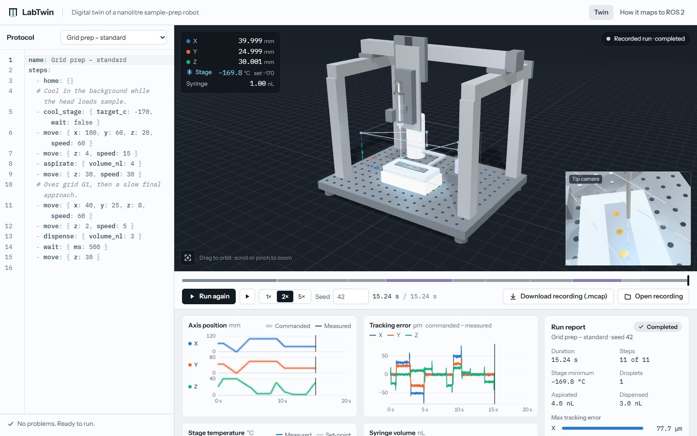
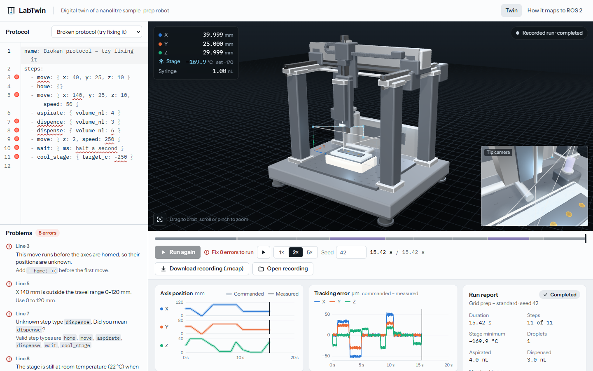
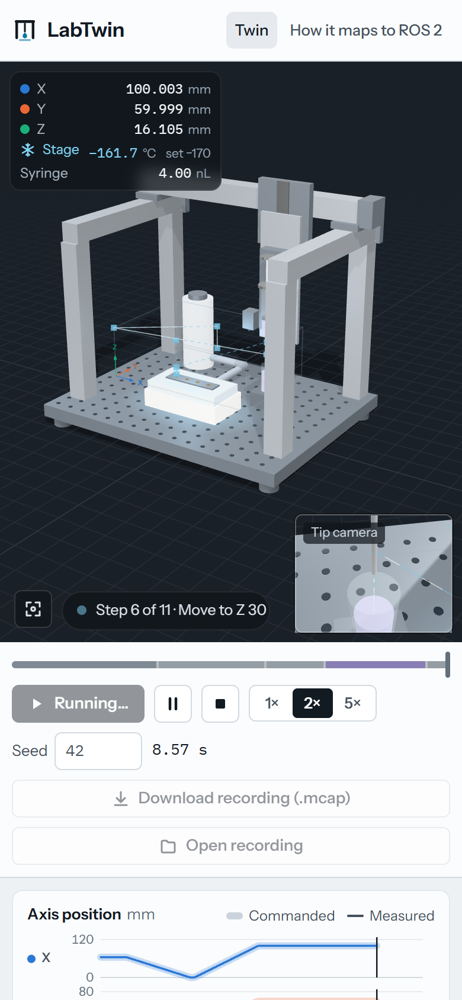
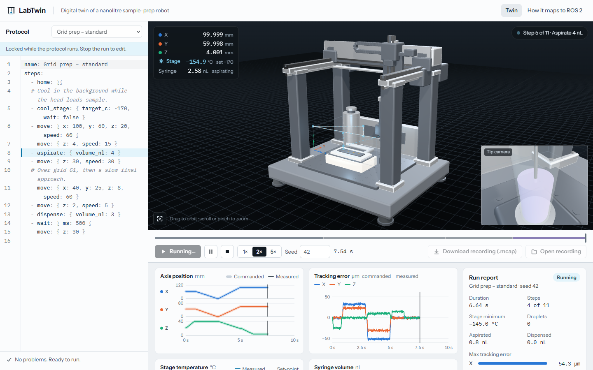
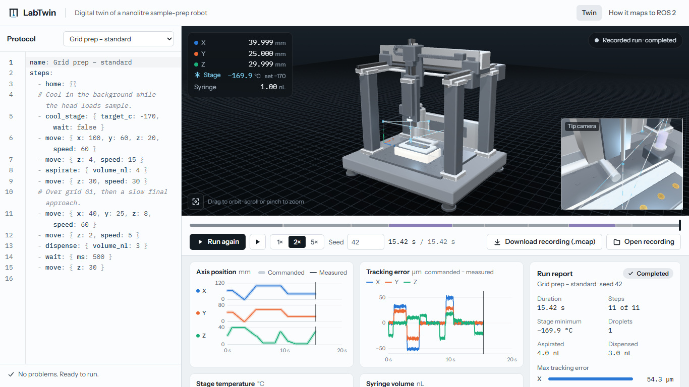
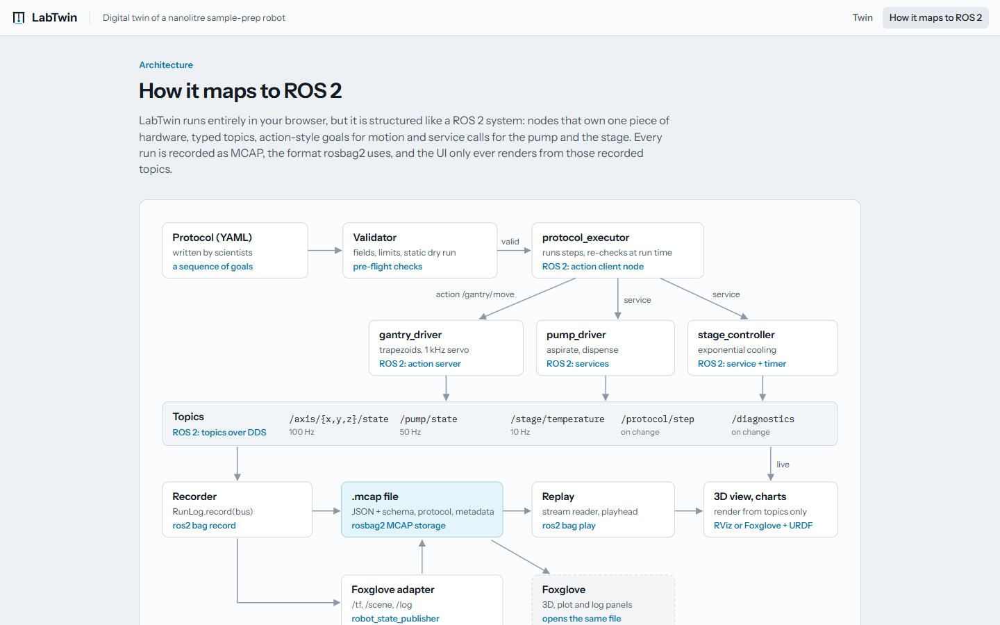
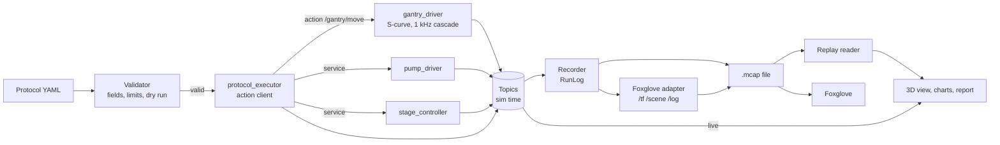
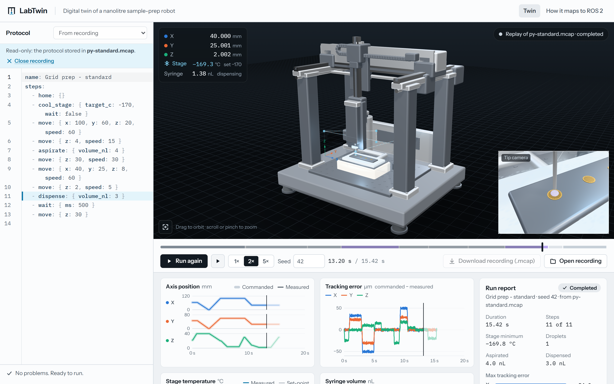

<h1 align="center">LabTwin</h1>

<p align="center">
  <b>A browser digital twin of a nanolitre sample-prep robot.</b><br/>
  Write a protocol, get it checked line by line, watch a deterministic 3-axis simulation in 3D,
  and record or replay every run as an MCAP file that opens in Foxglove —<br/>
  with a <b>real ROS 2 (rclpy) package</b> that shares the same interfaces.
</p>

<p align="center">
  <a href="https://labtwin.pages.dev"></a>
  <a href="https://github.com/yashvardhancse/labtwin/actions/workflows/ci.yml"></a>
  <a href="https://github.com/yashvardhancse/labtwin/actions/workflows/ros2.yml"></a>
  <a href="LICENSE"></a>
</p>

<p align="center">
  
  
  
  
  
  
</p>

**▶ Live demo: https://labtwin.pages.dev** &nbsp;·&nbsp; [How it maps to ROS 2](https://labtwin.pages.dev/#/ros2) &nbsp;·&nbsp; [Architecture](docs/ARCHITECTURE.md)



<table>
  <tr>
    <td width="62%"></td>
    <td width="38%"></td>
  </tr>
</table>

<details>
<summary>More screenshots: mid-run, a 1366 × 768 laptop, the ROS 2 mapping page</summary>





</details>

Everything runs client-side: no backend, nothing leaves the browser.

## What it demonstrates

| Area                                                      | Where to look                                                                                                                                                                                                                                                                                                                                                                                                                                                                                                                                             |
| --------------------------------------------------------- | --------------------------------------------------------------------------------------------------------------------------------------------------------------------------------------------------------------------------------------------------------------------------------------------------------------------------------------------------------------------------------------------------------------------------------------------------------------------------------------------------------------------------------------------------------- |
| **ROS 2 nodes and topic design**                          | A real ROS 2 (`rclpy`) package in [`ros2/`](ros2/) with `labtwin_msgs` interfaces (messages, a `MoveTo` action, services) and a node publishing the topics. In the browser, simulated nodes (`gantry_driver`, `pump_driver`, `stage_controller`, `protocol_executor`) talk over the same typed topics with action-style goals and service calls. Both sides share one machine model, and a Python-written recording replays in the web twin (below). See [`src/core/nodes`](src/core/nodes), [`ros2/`](ros2/) and the in-app page _How it maps to ROS 2_. |
| **Recording and replaying runs with MCAP and a 3D model** | Every run is recorded. _Download recording (.mcap)_ writes JSON channels with JSON Schemas, the protocol as an attachment and run metadata. _Open recording_ replays it with a scrubber. The file also carries `/tf`, `/scene` and `/log` (validated against Foxglove's official schemas), so Foxglove's 3D panel can show the moving gantry. Checked by a round-trip test, an indexed-reader test, the official **Python** `mcap` reader in CI, and a browser end-to-end test.                                                                           |
| **Tools that let scientists write and check protocols**   | A YAML editor with live validation: unknown steps and fields (with "did you mean"), types and ranges, axis, speed, volume and temperature limits, ordering ("home before moving", "stage cold before dispensing") and physical warnings (fast approach, off-grid dispense). Every message says what is wrong and how to fix it, and points at the exact token.                                                                                                                                                                                            |
| **Reproducible builds, containers and automated tests**   | A pinned toolchain (`.nvmrc`, `package-lock.json`, `npm ci`) and a multi-stage `Dockerfile` (lint, test, build, then an unprivileged nginx). CI runs lint, 85 web unit tests, the build, an MCAP interop check, a Docker smoke test, plus a ROS 2 workflow that lints and runs the 17 Python tests and verifies the Python-to-web MCAP interop (the ROS 2 workspace builds with `colcon`; see `ros2/`). Both simulators are bit-for-bit deterministic for a given seed.                                                                                   |
| **Code review and documentation**                         | Strict TypeScript with a type-aware ESLint boundary (`src/core` cannot import React, three.js or DOM APIs) and a ruff-linted, pytest-tested Python package; small, reviewable commits; this README, [`ros2/README.md`](ros2/README.md) and [`docs/ARCHITECTURE.md`](docs/ARCHITECTURE.md) with the design decisions and trade-offs.                                                                                                                                                                                                                       |

## Try it in 60 seconds

1. **Open the demo.** A run starts by itself. The head homes, the stage frosts over while the head draws 4 nL from the vial, then it writes a 3 nL droplet onto grid G1 (watch the _tip camera_). The editor highlights the step that is running.
2. **Break something.** Pick _Broken protocol_ from the examples menu: eight mistakes are underlined, each with its line number and a fix. _Run protocol_ stays disabled until they are fixed.
3. **Replay it.** After a run, click _Download recording (.mcap)_, then _Open recording_ (or drop the file on the page). Scrub the timeline; the 3D view, the readouts and the charts follow the playhead. The same file opens in [Foxglove](https://foxglove.dev).

## Architecture



The key decision is that **the 3D view, the charts and the run report render only from recorded topics**, never from simulator internals. A live run and a replayed file go through exactly the same code, so if a run renders live, its recording replays. More decisions and their trade-offs are in [`docs/ARCHITECTURE.md`](docs/ARCHITECTURE.md).

```text
src/
  core/     pure TypeScript, no React/DOM (runs in the browser, in vitest and in Node)
    protocol.ts  validate.ts  yamlSource.ts     protocol language and validator
    trajectory.ts  sim.ts  nodes/  rng.ts       planner, deterministic simulator, ROS 2-style nodes
    bus.ts  topics.ts  runLog.ts  scene.ts      topics, recorder, state at a playhead
    mcap.ts  foxglove.ts  geometry.ts           MCAP I/O, Foxglove adapter, URDF-like machine model
  three/    MachineView: three.js scene generated from core/geometry.ts
  ui/       React: editor (CodeMirror 6), transport, SVG charts, report, ROS 2 page
ros2/       real ROS 2 (rclpy) package: labtwin_msgs + a node publishing the topics
scripts/    headless export, Python MCAP verifier, screenshots, browser e2e
```

## Real ROS 2 package (`ros2/`)

The role's stack is ROS 2 in Python and C++, so the repo includes a real ROS 2
package, not just a browser demo. [`ros2/`](ros2/) has `labtwin_msgs` (the
`AxisState`/`PumpState`/… messages, a `MoveTo` action and `Aspirate`/`Dispense`/
`SetStageTarget` services) and `labtwin_sim`, an `rclpy` node that runs the same
deterministic machine model and publishes the same topics.

Because both sides share the topic names and JSON Schemas, **a recording written
by the Python/ROS 2 side opens and replays in the browser twin** — the 3D
machine, charts and report follow the Python-recorded state:



```bash
# Pure-Python core (no ROS 2 needed): write a recording the web app can open
cd ros2/src/labtwin_sim && pip install mcap pyyaml && python -m labtwin_sim.run standard out.mcap
pytest -q                                   # S-curve, determinism, MCAP round-trip

# As ROS 2 (Jazzy)
cd ros2 && colcon build && source install/setup.bash
ros2 launch labtwin_sim bringup.launch.py   # publishes /axis/* /pump/state /stage/temperature …
```

CI lints the Python package, runs its 17 tests and checks the MCAP interop on
every push; `colcon build` is a local/dev step. See [`ros2/README.md`](ros2/README.md) for the full interface list
and the interop details.

## Protocol reference

A protocol is YAML: a `name` and a list of `steps`, each `- <type>: { <fields> }`.

```yaml
name: Grid prep – standard
steps:
  - home: {}
  - cool_stage: { target_c: -170, wait: false }
  - move: { x: 100, y: 60, z: 20, speed: 60 }
  - move: { z: 4, speed: 15 }
  - aspirate: { volume_nl: 4 }
  - move: { z: 30, speed: 30 }
  - move: { x: 40, y: 25, z: 8, speed: 60 }
  - move: { z: 2, speed: 5 }
  - dispense: { volume_nl: 3 }
  - wait: { ms: 500 }
  - move: { z: 30 }
```

| Step         | Fields (units, range, default)                                                             | Behaviour                                                                                                                                                                 |
| ------------ | ------------------------------------------------------------------------------------------ | ------------------------------------------------------------------------------------------------------------------------------------------------------------------------- |
| `home: {}`   | none                                                                                       | References the axes: Z up to 40 mm first, then X and Y to 0. Required before any `move`.                                                                                  |
| `move`       | `x` 0–120 mm, `y` 0–80 mm, `z` 0–40 mm (at least one); `speed` > 0 to 100 mm/s, default 20 | Straight-line move of the needle tip; omitted axes keep their position. Each axis limit (X/Y 100 mm/s, Z 40 mm/s) can cap the path speed.                                 |
| `aspirate`   | `volume_nl` 1–10 nL (required); `rate_nl_s` 0.5–5 nL/s, default 2                          | Draws sample into the 10 nL syringe. The tip should be in the vial (X 100, Y 60, Z ≤ 6 mm).                                                                               |
| `dispense`   | same fields as `aspirate`                                                                  | Writes sample onto the grid under the tip. Needs enough sample and a stage set-point of −150 °C or colder.                                                                |
| `wait`       | `ms` > 0, up to 600 000                                                                    | Pauses the protocol.                                                                                                                                                      |
| `cool_stage` | `target_c` −190 to 30 °C (required); `wait` true/false, default `true`                     | Sets the cryo-stage set-point and waits until it is within ±2 °C. With `wait: false` the protocol carries on and a later `dispense` holds until the stage is cold enough. |

Deck: grids **G1–G4** at (40, 25), (50, 25), (60, 25), (70, 25) mm; sample vial at (100, 60) with its liquid surface at Z 6 mm. Z is the tip height above the grid plane.

**Errors** (block the run): YAML syntax, protocol shape, unknown step or field (with suggestions), missing field, wrong type, empty move, axis limit, speed limit, volume limit, rate limit, temperature range, wait range, moving before homing, syringe overflow, dispensing more than the syringe holds, and dispensing onto a warm stage.

**Warnings** (the run is allowed): missing name, path speed capped by an axis limit, fast approach below Z 5 mm, aspirating outside the vial, dispensing off-grid or from higher than 5 mm, and not retracting at the end.

The executor re-checks the important preconditions at run time as well: a dispense holds until the stage is actually cold and aborts with an error if it never gets there.

## Topics

| Topic                 | Schema                     | Rate                         | Fields                                                                                       |
| --------------------- | -------------------------- | ---------------------------- | -------------------------------------------------------------------------------------------- |
| `/axis/{x,y,z}/state` | `labtwin.AxisState`        | 100 Hz                       | `axis`, `cmd_mm`, `actual_mm`, `velocity_mm_s`, `homed`                                      |
| `/pump/state`         | `labtwin.PumpState`        | 50 Hz and on change          | `volume_nl`, `flow_nl_s`, `mode`                                                             |
| `/stage/temperature`  | `labtwin.StageTemperature` | 10 Hz                        | `celsius`, `target_c`                                                                        |
| `/protocol/step`      | `labtwin.ProtocolStep`     | on change                    | `index`, `type`, `status` (`executing`, `succeeded`, `aborted`, `canceled`), `line`, `label` |
| `/diagnostics`        | `labtwin.Diagnostic`       | on change                    | `level` (`OK`, `WARN`, `ERROR`), `name`, `message`                                           |
| `/tf`                 | `foxglove.FrameTransforms` | 50 Hz                        | `world` → `gantry_y` → `carriage_x` → `head_z` (the needle tip)                              |
| `/scene`              | `foxglove.SceneUpdate`     | 1 Hz and after each dispense | machine geometry per link, droplets                                                          |
| `/log`                | `foxglove.Log`             | on change                    | step transitions and diagnostics                                                             |

**Recording layout.** One JSON-encoded channel per topic, each with a JSON Schema. `protocol.yaml` is stored as an attachment, and a `labtwin.run` metadata record holds the seed, protocol name, duration, step count, outcome and start time. Log time is the wall-clock start plus simulation time. Chunk, message, attachment and metadata indexes plus statistics are written, so readers can seek. The three Foxglove schemas are vendored from `@foxglove/schemas`; a test fails if they drift, and every exported message is validated against them.

**In Foxglove:** open the file, add a 3D panel with display frame `world` to see the gantry move, and a Plot panel with `/axis/x/state.cmd_mm` and `/axis/x/state.actual_mm`.

## Run it locally

Needs Node 22.18 or newer (`.nvmrc`).

```bash
npm ci
npm run dev                 # http://localhost:5173
```

| Command                                         | What it does                                                                                                                                                                     |
| ----------------------------------------------- | -------------------------------------------------------------------------------------------------------------------------------------------------------------------------------- |
| `npm run lint`                                  | ESLint (strict, type-aware) and Prettier check                                                                                                                                   |
| `npm test`                                      | 85 unit tests: validator (every error class), S-curve and trapezoid profiles, simulator determinism and behaviour, MCAP round trip, indexed reading, Foxglove schema conformance |
| `npm run build`                                 | type-check, then a production build in `dist/`                                                                                                                                   |
| `npm run e2e`                                   | browser end-to-end: demo run, download .mcap, open it, replay and scrub (needs `npm run dev` and a local Chrome or Edge)                                                         |
| `npm run screenshots`                           | regenerate `docs/screenshots/`                                                                                                                                                   |
| `node scripts/export-sample.ts series out.mcap` | run an example headless with the same core and write an MCAP file                                                                                                                |
| `python scripts/verify_mcap.py out.mcap`        | verify that file with the official Python reader (`pip install -r scripts/requirements.txt`)                                                                                     |

## Docker

```bash
docker compose up --build   # http://localhost:8080
```

The build stage pins Node, installs the exact lockfile with `npm ci`, and runs lint, the tests and the build. The image only serves `dist/`, from an unprivileged nginx on port 8080.

## Deploy

The live demo runs on **Cloudflare Pages**: import the repository (framework preset _Vite_, build command `npm run build`, output `dist`, `NODE_VERSION=22`), or build locally and drag `dist/` in. It also works on **Vercel** with the same defaults, and on any static host — the site uses relative asset paths (`base: './'`) and hash routing, so it needs no rewrite rules and works under any path.

**GitHub Pages** is available too as an optional path: enable **Settings → Pages → Source: GitHub Actions**, then run the `deploy.yml` workflow from the Actions tab (it is manual-only so it never fails a push for repos that use another host).

## Limitations

- The physics is a deliberately small model: jerk-limited S-curve motion and a cascaded P/PI servo with feed-forward at 1 kHz, plus an exponential cooling curve. Time constants are compressed for the demo; a real cryo-stage takes minutes, not seconds.
- Droplets are drawn 10× their true size so a few nanolitres are visible.
- Recordings use JSON with uncompressed chunks (about 1.4 MB for the 15 s demo), which keeps them readable and easy to decode in the browser.
- Replay reads JSON-encoded MCAP. ROS 2 bags with CDR-encoded messages are listed in the roadmap.

## Roadmap

The ROS 2 package in [`ros2/`](ros2/) already exists; these are the next steps.

1. **Split into one node per driver:** promote `labtwin_sim`'s single node into `gantry_driver` (a `MoveTo` action server), `pump_driver`/`stage_controller` (service servers) and a `protocol_executor` client, matching the diagram.
2. **C++ drive bridge:** an `rclcpp` node modelling the CODESYS/EtherCAT boundary — the trajectory and servo run on the PLC at the fieldbus cycle; ROS 2 commands it and reads state.
3. **rosbag2 interop:** replay native `ros2 bag record -s mcap` (CDR-encoded) in the browser, which needs a CDR decoder.
4. **Foxglove bridge:** connect the web view to a live robot through the `foxglove_bridge` WebSocket.
5. **URDF export:** generate URDF/xacro from the machine description in `src/core/geometry.ts`.
6. **Camera node:** publish the tip camera as `sensor_msgs/CompressedImage`.
7. **Motion:** input shaping to cancel residual vibration, and fault injection such as a stalled axis or a pump occlusion.

## License

MIT
